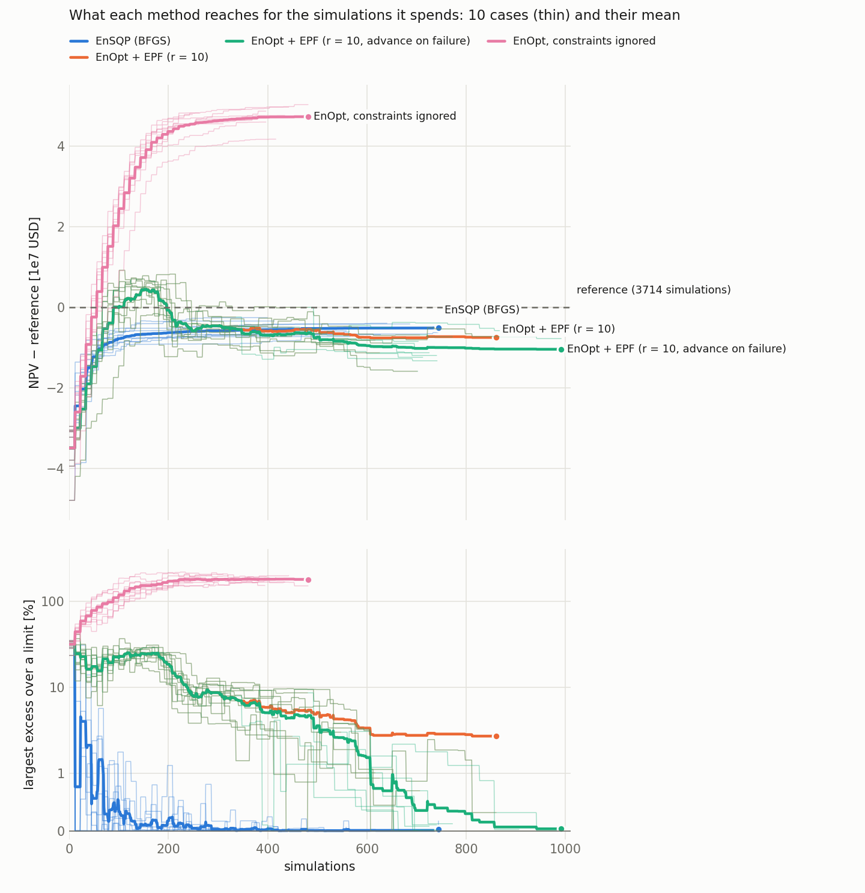

# popt on MiniRes: results

Generated by `run.py`; do not edit by hand. See `problem.py` for the problem, `optimizers.py` for the
methods and their settings, and `scoring.py` for what is scored. Each cell is the mean over the
cases (permeability fields), ± its standard error. The net present value of a run that violates a
constraint is not comparable with that of one that does not: read it together with the excess
columns, which give the largest violation as a fraction of the limit. The reference is not an
ensemble method: it differentiates the simulator by finite differences.

## Injection rates for net present value, under a water-production cap and an injection capacity

10 cases, 10 members for 32 controls. PET at `5aa86d2-dirty`, 2026-11-17.

| | NPV [1e7 USD] | NPV − reference | water-cap excess | capacity excess | feasible runs | simulations |
|---|---|---|---|---|---|---|
| EnSQP (BFGS) | 43 ± 0.28 | -0.505 ± 0.049 | 0.000234 ± 0.00017 | 6.37e-11 ± 3.3e-11 | 9 of 10 | 565 |
| EnOpt + EPF (r = 10) | 42.7 ± 0.36 | -0.743 ± 0.14 | 0.00348 ± 0.0024 | 0.0271 ± 0.0098 | 1 of 10 | 590 |
| EnOpt + EPF (r = 10, advance on failure) | 42.4 ± 0.29 | -1.04 ± 0.098 | 0 ± 0 | 0.000345 ± 0.00015 | 8 of 10 | 774 |
| EnOpt, constraints ignored | 48.2 ± 0.33 | 4.73 ± 0.077 | 1.78 ± 0.061 | 1.49 ± 0.0042 | 0 of 10 | 378 |
| SLSQP, finite differences (reference) | 43.5 ± 0.28 | 0 ± 0 | 0.000179 ± 0.00018 | 4.84e-05 ± 4.8e-05 | 9 of 10 | 3714 |

Thin lines are the cases, the thick line their mean. A run that has stopped is held at where it
ended, so each mean line ends, at the simulations of the method's longest run, on the table's
"NPV − reference".
